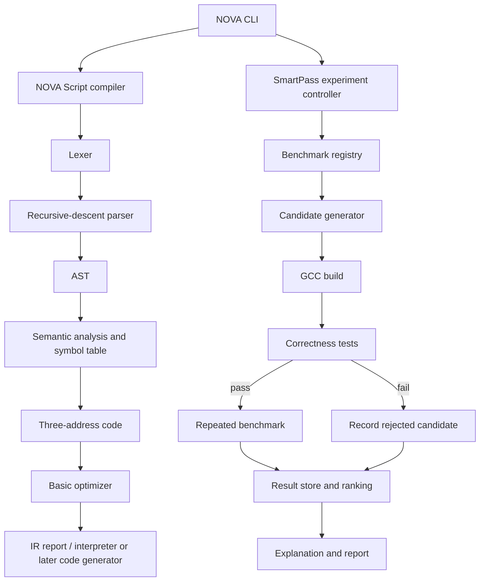

# NOVA — Master Project Specification

> Design pack prepared 14 October 2026. This is a proposed implementation plan; the features and commands are not represented as already implemented.


# NOVA — Project Documentation Pack

**Project title:** *NOVA: An Explainable, Workload-Aware Compiler Optimization Framework for Numerical Programs*  
**Implementation language:** C++17  
**Build system:** CMake  
**Interface:** Terminal CLI  
**Initial host compiler for C++ benchmarks:** GCC  
**Status:** Design and implementation plan; commands and features described as planned are not yet implemented unless explicitly marked otherwise.

## 1. What NOVA is

NOVA has two deliberately separate tracks:

1. **NOVA Compiler (educational track):** a small custom language called NOVA Script demonstrates compiler stages: lexical analysis, recursive-descent parsing, AST construction, symbol-table and semantic checks, three-address code (TAC), and basic optimizations.
2. **NOVA SmartPass (research track):** a bounded experiment controller for numerical C++ benchmarks. It invokes GCC to build candidate configurations, checks their outputs, measures execution time and binary size, and records evidence for the best valid candidate it found.

**Important boundary:** NOVA does not compile arbitrary C++ itself and is not a replacement for GCC. In the initial design, GCC compiles the C++ benchmark source. SmartPass selects and evaluates configurations around GCC. NOVA Script is a separate, intentionally small language.

## 2. Research claim — phrased carefully

The proposed research question is:

> Under a fixed evaluation budget, can a workload-aware adaptive search strategy find strong GCC configurations for selected numerical C++ workloads more efficiently than fixed defaults and random search, while rejecting incorrect candidates and producing reproducible explanations?

This is a hypothesis to test, not a result we can assume. A project result may be positive, mixed, or negative. Do not claim speedups until measurements support them.

## 3. Scope

### In scope for the first complete version
- C++17 / CMake / terminal-only workflow.
- NOVA Script lexer, parser, AST, semantic analysis and TAC.
- Basic semantics-preserving optimizations: constant folding, constant propagation, algebraic simplification and dead-code elimination, each behind tests.
- GCC `-O2` and `-O3` baselines for C++ numerical kernels.
- Bounded candidate search over a small, explicit configuration space.
- Correctness checks before performance ranking.
- Repeated timings, machine/compiler metadata, JSON/CSV results and explanations.
- Comparison against fixed-default and random-search baselines.

### Explicitly out of scope initially
- A complete C++ parser or C++ compiler.
- Replacing GCC or LLVM.
- Claiming universal speedups.
- GPU/CUDA tuning, multithreaded tuning, automatic arbitrary source rewriting, or production-grade profile-guided optimization in the first release.
- A GUI or web dashboard.
- LLVM integration in the initial implementation.

## 4. Quick project map

```text
nova/
├── CMakeLists.txt
├── README.md
├── docs/
│   ├── 01-product-requirements.md
│   ├── 02-architecture.md
│   ├── 03-research-and-novelty.md
│   ├── 04-roadmap.md
│   ├── 05-testing.md
│   ├── 06-benchmark-protocol.md
│   ├── 07-developer-guide.md
│   └── 08-references.md
├── include/nova/
├── src/
│   ├── cli/
│   ├── frontend/
│   ├── ir/
│   ├── optimizer/
│   └── smartpass/
├── tests/
│   ├── unit/
│   ├── integration/
│   └── regression/
├── examples/
│   ├── basic.nova
│   ├── matmul.cpp
│   └── vector_add.cpp
├── benchmarks/
│   ├── README.md
│   ├── configs/
│   └── results/
└── scripts/
```

This is a proposed structure; create files incrementally as each phase is implemented.

## 5. Build policy

Use C++17 and CMake. Prefer a clean build directory and a testable CLI. GCC is the first supported host compiler, but avoid GCC-specific behavior in the NOVA Script frontend unless documented.

```bash
cmake -S . -B build -DCMAKE_BUILD_TYPE=Release
cmake --build build --parallel
ctest --test-dir build --output-on-failure
```

These commands become usable after the initial scaffold and CMake targets have been created.

## 6. CLI contract (planned)

```bash
nova --help
nova compile examples/basic.nova --show-all
nova tokens examples/basic.nova
nova ast examples/basic.nova
nova tac examples/basic.nova
nova optimize examples/basic.nova
nova bench matrix
nova tune matrix --budget 12
nova explain latest
```

The CLI must return a non-zero exit code for invalid source, failed builds, failed correctness checks, or malformed configuration. Do not silently treat a failed candidate as a slow candidate.

## 7. Project rules

- Every optimization has a written semantic rule and unit tests.
- Every SmartPass candidate is recorded, including failures.
- The baseline is always evaluated and never removed from the result set.
- Candidate ranking only includes candidates that built and passed correctness checks.
- Benchmark source, compiler version, flags, input size, machine/OS, timing method and run count are recorded.
- No benchmark results are invented, selectively omitted or presented without context.
- Do not compare results measured on different machines as if they were directly comparable.
- `-Ofast` is optional and must be labelled separately because it permits transformations that may violate strict language-standard floating-point behavior.
- All claims must identify the benchmark set and hardware/software conditions under which they were observed.

## 8. Definition of done

NOVA is ready for a credible demonstration when:
1. The educational compiler has tests for valid and invalid programs and exposes its intermediate stages.
2. SmartPass runs a bounded search reproducibly.
3. Incorrect candidates are rejected.
4. Baselines and search strategies are compared under the same budget.
5. Results include variability and tuning overhead, not just the best runtime.
6. The report explains limitations and does not overclaim generality.


---


---


# 01 — Product Requirements and Problem Definition

## 1. Problem statement

Developers who want faster numerical code face several related tasks: understanding optimization levels and compiler options, deciding which configurations to test, validating that transformed/build variants preserve correct output, and determining whether measured speedups are repeatable. NOVA addresses a deliberately narrow version of this problem for selected numerical C++ programs.

This is not a claim that every developer has this problem or that NOVA solves all performance engineering. The problem framing is grounded in the existence and complexity of compiler configuration choices, established autotuning research, and formal benchmark-reproducibility guidance. A user study or developer survey would be needed to make stronger claims about prevalence.

## 2. Evidence used to source the problem

| Observed problem area | Evidence | What NOVA does about it | What the evidence does *not* prove |
|---|---|---|---|
| Compiler optimization choices have trade-offs and many options | GCC's official optimization manual documents distinct `-O` levels, many individual flags, and different speed/size/debugging trade-offs. [R1] | Starts with a small, declared search space; records exact flags and compares results for each workload. | It does not prove that developers universally find flags confusing. |
| Search spaces can be large and no one search method works best for every problem | The OpenTuner paper discusses domain-informed search-space representations, intractable spaces, and differences among problem search landscapes. [R2] | Tests a workload-feature-guided adaptive search against fixed and random baselines under equal evaluation budgets. | It does not establish that NOVA's proposed strategy is new or superior. |
| Performance results can be noisy and need repeatable methodology | Google Benchmark documents repetition controls and random interleaving; SPEC's run rules emphasize repeated runs, validation and reproducibility. [R3, R4] | Uses repeated measurements, preserves raw samples, records the environment and reports median plus spread. | NOVA's small educational benchmarks are not SPEC-certified results. |
| Compiler optimizations can affect semantics or require proof/validation | GCC documents that `-Ofast` enables transformations not valid for all strictly standard-compliant programs; Souper demonstrates synthesis-based optimization of LLVM IR. [R1, R5] | Correctness-checks candidate outputs and keeps aggressive floating-point modes separate. | Output tests are not a formal proof of equivalence for every possible input. |
| Compiler construction itself has many stages | LLVM's Kaleidoscope tutorial presents a staged implementation of lexer, parser/AST, IR generation and optimizer/JIT extensions. [R6] | Builds a small, explainable language frontend without taking on full C++ parsing. | NOVA does not implement LLVM or its complete backend. |

## 3. User-facing outcomes

A user should be able to:
- See the token stream, AST and TAC for a NOVA Script program.
- See which semantic rule rejected an invalid program.
- Inspect each basic optimization before and after.
- Run a numerical benchmark with GCC baseline settings.
- Run SmartPass with a declared budget.
- See every candidate, build status, correctness status, flags, runtime samples, binary size and reason for acceptance/rejection.
- Re-run an experiment using the recorded configuration.

## 4. Functional requirements

### Compiler track
- FR-C1: Tokenize identifiers, integer literals, keywords, operators, punctuation and comments.
- FR-C2: Track source line/column for useful diagnostics.
- FR-C3: Parse expressions with correct operator precedence and parentheses.
- FR-C4: Construct an AST independent of printed formatting.
- FR-C5: Maintain a symbol table and reject undeclared/redeclared variables according to the language rules.
- FR-C6: Generate deterministic TAC.
- FR-C7: Apply each optimizer pass in isolation and expose before/after IR.
- FR-C8: Stop optimization when no changes occur or a documented pass limit is reached.

### SmartPass track
- FR-S1: Define benchmarks and candidate configurations declaratively.
- FR-S2: Include baseline candidates in every experiment.
- FR-S3: Compile candidates through an argument-list process invocation, not a shell-concatenated string.
- FR-S4: Capture compiler exit code and diagnostics.
- FR-S5: Run correctness tests before benchmarking.
- FR-S6: Run multiple timing repetitions and retain raw data.
- FR-S7: Enforce a candidate-evaluation budget.
- FR-S8: Record failed candidates instead of silently dropping them.
- FR-S9: Select only from valid candidates according to a declared objective.
- FR-S10: Emit a machine-readable report and human-readable explanation.
- FR-S11: Record compiler version, command, source hash, machine/OS, inputs and timing protocol.

## 5. Non-functional requirements
- Deterministic behavior for compiler stages given the same input.
- Reproducible experiment configuration.
- Clear separation between educational compiler and C++ benchmark runner.
- Small enough implementation for a student to explain line by line.
- No claim of correctness based only on a single output example.
- No claim of speedup based on a single timing run.
- No hidden network calls or external service dependency at runtime.

## 6. Constraints and assumptions
- C++17 is the implementation language.
- CMake is the build system.
- Terminal-only interface.
- GCC is the initial C++ benchmark compiler.
- First benchmark family is numerical kernels, beginning with matrix multiplication.
- The custom language is intentionally not C++.
- Initial research scope is CPU/single-process only.


---


# 02 — Architecture and Workings

## 1. Two-track architecture



The Mermaid diagram is a proposed design, not a screenshot of implemented software.

## 2. NOVA Script language — initial grammar

Start small. Version 0.1 supports integer variables, arithmetic, assignment and `print`. Add `if` and `while` only after the initial frontend is stable.

Example:

```text
let x = 10;
let y = 20;
let z = x * 2 + y;
print z;
```

A minimal grammar:

```ebnf
program     = { statement } ;
statement   = "let" identifier "=" expression ";"
            | identifier "=" expression ";"
            | "print" expression ";" ;
expression  = term { ("+" | "-") term } ;
term        = unary { ("*" | "/") unary } ;
unary       = [ "-" ] primary ;
primary     = integer | identifier | "(" expression ")" ;
```

Implementation note: if unary operators or declarations are not implemented in the current phase, remove them from the accepted grammar rather than accepting syntax the parser cannot correctly handle.

## 3. Frontend components

### Lexer
Input: source text. Output: token sequence with kind, lexeme and source location.
- Must distinguish `=` assignment from `==` comparison once comparisons are introduced.
- Must report unknown characters with location.
- Must have tests for empty input, whitespace, comments, integers, identifiers and invalid symbols.

### Parser
Use recursive descent for statements and precedence-layered expression parsing.
- A parser error should include the unexpected token and source location.
- Do not use string matching as a substitute for parsing.
- AST nodes should represent meaning, not just retain source strings.

### AST
Recommended node families:
- `Program`
- `LetStmt`, `AssignStmt`, `PrintStmt`
- `IntegerExpr`, `VariableExpr`, `UnaryExpr`, `BinaryExpr`

Use `std::unique_ptr` for AST ownership or another consistent ownership strategy. Avoid raw owning pointers.

### Semantic analysis and symbol table
Initial type system: integers only.
- Reject use-before-declaration.
- Reject duplicate declarations in the same scope.
- Reject invalid assignment targets.
- Define division behavior explicitly; do not leave divide-by-zero behavior ambiguous.
- If lexical scopes are added later, represent them explicitly.

### Three-address code (TAC)
Example expression:

```text
let z = x * 2 + y;
```

Possible TAC:

```text
t1 = x * 2
t2 = t1 + y
z = t2
```

The exact temporary naming policy should be deterministic to make golden tests reliable.

## 4. Basic optimizer

Passes are educational and should be independently testable:
1. Constant folding: `t1 = 2 + 3` → `t1 = 5`
2. Constant propagation: `x = 4; y = x + 1` → `x = 4; y = 5` where semantics permit.
3. Algebraic simplification: `x + 0` → `x`, only when valid under language semantics.
4. Dead-code elimination: remove assignments whose values are never used, provided removal cannot remove observable effects or exceptions.

Rules:
- Preserve semantics.
- Avoid unsafe floating-point identities if floating point is later added.
- Run differential tests against a reference interpreter for randomly generated small programs where feasible.
- Document which optimizations are implemented; do not advertise future passes as completed.

## 5. SmartPass data model

Each experiment should capture:
- experiment ID and timestamp;
- benchmark ID and source hash;
- input parameters and correctness test set;
- host compiler name/version;
- exact argument vector for each candidate;
- NOVA version / Git commit;
- OS, CPU model, logical core count, RAM and relevant environment;
- build status, correctness status and failure reason;
- raw timing samples, median, minimum and spread statistic;
- binary size;
- tuning budget, number of candidates attempted and total tuning wall time;
- selection rule and selected candidate ID.

Use JSON for full metadata and CSV for a flat candidate table. Do not store only the best candidate.

## 6. Candidate lifecycle

```text
GENERATED
  -> BUILD_FAILED                 (record; never benchmark)
  -> BUILT
       -> CORRECTNESS_FAILED      (record; never rank as valid)
       -> CORRECT
            -> BENCHMARKED
                 -> ELIGIBLE
                 -> REJECTED_BY_POLICY
```

A candidate with missing correctness results is not eligible. A candidate with fewer timing samples than the configured protocol should be marked incomplete.

## 7. Search strategy, staged

### First working version
Use a deterministic candidate list and a fixed budget. Include `-O2` and `-O3` as baselines. This is not yet adaptive research.

### Adaptive version
Use a small, inspectable heuristic:
- collect workload descriptors (e.g., matrix dimension, element type, operation family, whether loop tiling is a legal kernel parameter);
- collect previous outcomes for each candidate/configuration family;
- prioritize untested candidates expected to improve the objective;
- preserve exploration so the algorithm does not only repeat one family;
- compare against random search with the same candidate budget.

Do not claim this is machine learning unless a real learned model is implemented and evaluated. A transparent heuristic is easier to explain and can still be evaluated.

## 8. Security and process safety
- Invoke the compiler using a process API with separate arguments.
- Do not concatenate user-provided source paths or flags into shell commands.
- Restrict generated candidate flags to a whitelist.
- Use per-candidate output directories.
- Apply timeouts to build and benchmark processes.
- Capture stdout/stderr and exit codes.
- Avoid running arbitrary downloaded binaries; the initial tool should operate only on local project-controlled benchmark sources.


---


# 03 — Research Plan, Novelty and Related Work

## 1. Proposed research question

**RQ:** Under a fixed candidate-evaluation budget, can a workload-aware adaptive search strategy identify strong GCC configurations for selected numerical C++ workloads more efficiently than fixed optimization defaults and random search, while requiring correctness checks and producing reproducible explanations?

## 2. Proposed contribution

The candidate contribution is **adaptive, budget-aware compiler configuration tuning using workload descriptors and accumulated evaluation evidence**.

The contribution is not:
- writing a lexer/parser;
- running GCC with `-O2` and `-O3`;
- benchmarking code once;
- printing the fastest result;
- claiming universal superiority over GCC.

Those are standard components or weak claims on their own.

The research must establish whether the proposed search method adds value beyond straightforward alternatives. Existing autotuning literature means we must position NOVA as a small, focused evaluation of a particular search policy and workflow, not as the first compiler autotuner.

## 3. Related work and implications

### GCC optimization levels [R1]
GCC provides extensive optimization levels. Its documentation describes `-O2` as enabling many optimizations and `-O3` as enabling further loop and interprocedural transformations. `-Ofast` enables transformations that are not valid for all strictly standard-compliant programs.

**Implication:** A fair baseline must include strong standard configurations. NOVA must not claim that its own basic passes are automatically better than mature GCC optimizations. Keep `-Ofast` separate and disclose changed semantic assumptions.

### OpenTuner [R2]
OpenTuner is an extensible autotuning framework. Its paper discusses search-space size, domain-specific representations, different search landscapes and the use of multiple search techniques.

**Implication:** Autotuning is established prior art. NOVA must compare against a simple baseline and clearly specify what is different about its workload features, budget policy, objective and explanation/reporting.

### Google Benchmark [R3] and SPEC run rules [R4]
Google Benchmark documents repetition and timing controls. SPEC emphasizes output validation, repeated runs and reproducible reports.

**Implication:** The benchmark protocol must preserve raw timings, report repeated-run statistics and document the environment. Our own small benchmarks are not SPEC results and must not be described as such.

### Souper [R5]
Souper is a synthesizing superoptimizer for LLVM IR and demonstrates a different class of optimization: discovering equivalent IR expressions through synthesis.

**Implication:** NOVA's initial SmartPass does not synthesize transformations or optimize LLVM IR. Cite Souper as related work, not as an implemented component.

### egg / equality saturation [R7]
The `egg` work develops efficient equality-saturation infrastructure for rewrite-driven optimization and synthesis.

**Implication:** Equality saturation is a possible future direction, not part of the first implementation. Do not imply NOVA uses e-graphs.

### LLVM Kaleidoscope tutorial [R6]
The tutorial incrementally teaches lexer, parser/AST, IR generation and optimizer support for a small language.

**Implication:** It is a reference for compiler-stage organization. NOVA deliberately starts without LLVM to keep the implementation explainable and within scope.

## 4. Developer problems: what is sourced versus inferred

### Sourced problem framing
1. **Configuration space:** GCC exposes many optimization controls with different trade-offs [R1].
2. **Search complexity:** OpenTuner explicitly discusses large search spaces and the importance of domain-informed representations [R2].
3. **Trustworthy performance measurement:** Google Benchmark and SPEC provide guidance on repetition, validation and reproducibility [R3, R4].
4. **Semantic risk:** GCC's `-Ofast` documentation explicitly warns that some enabled transformations are not valid for all standard-compliant programs [R1].

### Design inference
From those sources, NOVA hypothesizes that a small workflow combining a fixed budget, workload descriptors, correctness gating and evidence reports may reduce the effort needed to explore a narrow class of optimization configurations.

That is an engineering hypothesis, not a demonstrated developer survey result. If the report claims “developers commonly struggle with X,” add a real survey, interviews or a specific study that supports the prevalence claim. Do not invent survey results or generalize from documentation alone.

## 5. Hypotheses

- H1: Adaptive search achieves a better best-valid runtime than random search on at least some workloads under the same candidate budget.
- H2: Workload descriptors improve search efficiency over the same adaptive policy without descriptors.
- H3: Some tuning gains persist on holdout input sizes not used to choose the candidate.
- H4: Any runtime improvement must be considered alongside compilation/tuning overhead and binary size.

These hypotheses can be rejected. Null or mixed results are valid findings.

## 6. Experimental baselines

At minimum:
1. GCC `-O2`.
2. GCC `-O3`.
3. Random candidate search with budget B.
4. NOVA adaptive search with the same budget B.
5. Optionally, exhaustive search over a small configuration space for an upper-bound reference on selected small cases.

Optional extensions:
- `-Ofast`, separately labelled with its semantic trade-offs.
- GCC profile-guided optimization (PGO), but only if the training/measurement workflow can be implemented correctly and documented. Do not call PGO a fair baseline if it has not been trained with representative data.

## 7. Metrics

- **Best-valid runtime:** median runtime of the selected candidate.
- **Speedup vs baseline:** `baseline_median / candidate_median`; values above 1 mean faster in this ratio.
- **Search regret:** candidate's result relative to the best known result in the evaluated search space, where an exhaustive reference is available.
- **Evaluation efficiency:** quality reached after B candidate evaluations.
- **Tuning overhead:** total wall time spent building, validating and timing candidates.
- **Binary size:** bytes of the executable.
- **Correctness pass rate:** valid candidates / candidates built and tested, with the denominator reported explicitly.
- **Robustness:** results across multiple input sizes and repeated experiment seeds.

## 8. Threats to validity

- Thermal throttling, background tasks and CPU frequency scaling can change timings.
- A benchmark may be too small, too simple or compiler-specific.
- Repeatedly tuning to one input size can overfit the benchmark.
- Output tests cannot prove correctness for all possible inputs.
- Different GCC versions or machines can change candidate ranking.
- Candidate flags may interact; one-factor-at-a-time search can miss interactions.
- A search budget that excludes compilation cost can make the method look better than it is.
- Matrix multiplication can be dominated by library/compiler/vectorization choices and is not representative of all programs.
- Selecting a winner from noisy measurements can overfit timing noise.

Mitigations: repeat runs, keep raw samples, use holdout input sizes, test more than one kernel, record environment, count compilation in tuning overhead and compare equal budgets.

## 9. Claim policy

Allowed after evidence:
- “On benchmark set X, machine Y, GCC version Z and the stated input sizes, the method achieved ...”
- “Under budget B, the adaptive strategy outperformed random search on N of M tested cases.”
- “No consistent improvement was observed on these cases.”

Not allowed without evidence:
- “NOVA is faster than GCC.”
- “NOVA beats every compiler.”
- “NOVA solves developer performance problems.”
- “This is the first workload-aware autotuner.”
- “Correctness is guaranteed” based only on finite tests.


---


# 04 — Phases, Versions and Release Gates

Treat the version labels as a proposed release plan. Do not mark a version complete until its gate passes.

## V0.1 — Foundation and CLI scaffold
**Goal:** buildable, testable C++17 project.

Deliverables:
- CMake project and `nova` executable.
- `--help`, version output, consistent exit codes.
- Unit-test target and CI-ready commands.
- Directory structure and style/lint conventions.

Gate:
- Clean configure/build succeeds.
- Tests run with CTest.
- No compiler warnings introduced by the project under the chosen warning policy.

## V0.2 — Lexer
**Goal:** source text becomes located tokens.

Deliverables:
- token enum, token structure, lexer.
- line/column tracking and useful lexical errors.
- token-dump command.

Gate:
- tests cover every token, whitespace/comments, end-of-file, invalid characters and locations.

## V0.3 — Parser and AST
**Goal:** parse the defined NOVA Script grammar.

Deliverables:
- recursive-descent parser.
- precedence-aware expression parser.
- AST nodes and AST printer.
- parser diagnostics.

Gate:
- valid examples produce expected ASTs.
- invalid examples fail cleanly without crashes.
- precedence and parentheses tests pass.

## V0.4 — Semantic analysis and TAC
**Goal:** catch invalid variable use and generate deterministic intermediate code.

Deliverables:
- symbol table.
- declaration/use checks.
- TAC generator and `tac` command.

Gate:
- tests cover use-before-declaration, duplicate declaration, valid assignment and deterministic temporary names.

## V0.5 — Basic optimizer
**Goal:** implement small, testable TAC transformations.

Deliverables:
- constant folding.
- constant propagation.
- safe algebraic simplification.
- dead-code elimination.
- before/after IR display.

Gate:
- unit tests per rule.
- semantic differential tests against an interpreter/reference evaluator.
- optimizer terminates and preserves observable behavior for tested cases.

## V0.6 — Benchmark lab and fixed baselines
**Goal:** produce reliable GCC baseline measurements before adaptive search.

Deliverables:
- matrix multiplication and vector-add benchmarks.
- correctness tests and deterministic inputs.
- GCC `-O2` and `-O3` build/run scripts.
- repeated timing collection and environment metadata.
- JSON/CSV result schema.

Gate:
- raw timings retained.
- each baseline passes correctness checks.
- repeatability/variance reviewed before any performance claim.

## V0.7 — Bounded SmartPass search
**Goal:** evaluate a finite set of candidate configurations.

Deliverables:
- candidate registry and whitelisted configuration space.
- `nova tune <benchmark> --budget B`.
- baseline always included.
- build/correctness/benchmark state machine.
- report with every candidate and rejection reason.

Gate:
- budget enforced.
- invalid candidates never selected.
- same candidate config can be replayed.
- random search baseline available.

## V0.8 — Adaptive workload-aware search
**Goal:** add the candidate research contribution.

Deliverables:
- workload descriptors.
- explicit adaptive candidate-priority policy.
- persistent experiment history.
- deterministic seeds and equal-budget comparisons.
- ablation: with and without workload features.

Gate:
- adaptive and random search run with equal budgets.
- results across multiple workloads/seeds.
- holdout sizes evaluated.
- no claim of generality from one benchmark.

## V0.9 — Evaluation and report
**Goal:** turn experiments into a reproducible research artifact.

Deliverables:
- plots/tables generated from raw data.
- methodology and threats-to-validity section.
- reproducibility command and environment manifest.
- report distinguishes measured outcomes from hypotheses.

Gate:
- a clean checkout can reproduce the pipeline.
- all claims trace to saved raw results.
- negative results and regressions are included.

## V1.0 — Demonstration-ready release
Requirements:
- all selected features pass tests;
- README build/run instructions are accurate;
- sample NOVA Script output is documented;
- benchmark results have provenance and repeated measurements;
- no feature is described as implemented if it is only planned.

## Scope control

Do not start LLVM integration, a full C++ frontend, machine-learning models, parallel/GPU tuning or GUI work before V0.9. If the core research cannot be evaluated reliably, extra features do not improve the quality of the result.


---


# 05 — Testing Strategy

## 1. Testing layers

### Unit tests
Test each component in isolation:
- lexer tokenization and source locations;
- parser precedence and AST shape;
- semantic rules and diagnostics;
- TAC emission;
- each optimizer rewrite;
- candidate configuration validation;
- timing statistics and report serialization.

### Integration tests
Run full CLI commands against example files:
- valid source through tokens, AST and TAC;
- invalid source returns non-zero and readable diagnostics;
- optimizer output is deterministic;
- benchmark candidate builds, executes and produces a report;
- failed build/correctness candidates are excluded from ranking.

### Regression tests
Every bug fix adds a small input and expected behavior. Keep both the source and expected diagnostic/output.

### Differential tests
For NOVA Script, create a small reference evaluator/interpreter and compare its results with the optimized and unoptimized execution path. This is valuable but does not constitute formal proof.

For C++ benchmarks, compare candidate output with a trusted reference implementation or expected checksum/tolerance policy. Floating-point comparisons must use a documented tolerance and account for numerical stability.

### Property/fuzz tests (later)
Generate small expressions/programs and check:
- lexer/parser never crash;
- valid generated programs parse;
- optimized and unoptimized executions agree for the supported semantics;
- TAC optimizer reaches a fixed point or reports its iteration cap.

## 2. Minimum test matrix

| Area | Example | Expected result |
|---|---|---|
| Lexer | `let x = 12;` | Expected token sequence |
| Lexer error | `let x = @;` | Location-aware error |
| Parser | `print 2 + 3 * 4;` | Multiplication nested under addition |
| Parser error | Missing semicolon | Clear parse error, non-zero exit |
| Semantics | `print missing;` | Undeclared-variable error |
| Semantics | Duplicate `let x` | Duplicate declaration error |
| Constant folding | `t1 = 2 + 3` | `t1 = 5` |
| Propagation | `x = 4; y = x + 1` | Fold/use constant where safe |
| DCE | unused pure assignment | Assignment removed |
| Correctness gate | deliberately wrong benchmark candidate | Rejected before timing/ranking |
| Budget | budget = 3 | At most three counted candidate evaluations, per documented definition |
| Repeatability | same source/config/seed | Same candidate sequence and metadata, timing naturally may vary |

## 3. Correctness policy for numerical benchmarks

- Use deterministic input generation with recorded seed.
- Validate all output elements, or use a checksum plus additional spot checks where full validation is too costly.
- For floating-point output, use a documented absolute/relative tolerance:
  `abs(actual - expected) <= atol + rtol * abs(expected)`.
- Run correctness validation before timing.
- Do not compile correctness and timed binaries with different candidate flags.
- If a candidate changes floating-point semantics, isolate it as a separate experimental condition.
- For integer kernels, prevent undefined behavior from overflow by choosing safe input bounds or using wider types.

## 4. Exit codes (proposed contract)

- `0`: command completed and all required checks passed.
- `1`: runtime/build/benchmark failure.
- `2`: CLI usage or configuration error.
- `3`: source lexical/syntax/semantic error.
- `4`: correctness failure.
- `5`: incomplete experiment or missing required measurements.

The exact mapping can be simplified in the implementation, but it must be documented and tested.

## 5. Test commands

Once targets exist:

```bash
cmake -S . -B build -DCMAKE_BUILD_TYPE=Debug
cmake --build build --parallel
ctest --test-dir build --output-on-failure
```

Run sanitizers in a separate build where supported:

```bash
cmake -S . -B build-asan \
  -DCMAKE_BUILD_TYPE=Debug \
  -DCMAKE_CXX_FLAGS="-fsanitize=address,undefined -fno-omit-frame-pointer"
cmake --build build-asan --parallel
ctest --test-dir build-asan --output-on-failure
```

Do not mix sanitizer builds into performance measurements.


---


# 06 — Benchmark Protocol and GCC Comparisons

## 1. Purpose

The benchmark lab answers a research question, not a marketing question. It must be able to show no improvement, regressions, and uncertainty. The first benchmark family is numerical kernels, starting with matrix multiplication.

## 2. Initial benchmark set

1. **Matrix multiplication:** `C = A × B`; start with a simple reference implementation. Later add a separately defined blocked-kernel variant if source/kernel parameters are part of the legal search space.
2. **Vector addition:** `out[i] = a[i] + b[i]`; simple memory-bandwidth/loop baseline.
3. **Iterative numerical workload:** add only after the first two are stable, with a well-defined correctness oracle.

Do not rely on a single matrix-multiplication benchmark for broad claims.

## 3. Baselines

For each benchmark/input:
- GCC `-O2`.
- GCC `-O3`.
- NOVA's candidate-search result under budget B.
- Random-search result under the same B.
- Optional `-Ofast`, clearly labelled because its semantics can differ from strict standard-conforming floating-point behavior.
- Optional PGO only after implementing and documenting the full generate-profile/train-use workflow.

Always record the GCC version. The meanings and enabled passes of optimization levels can vary by version and target.

## 4. Example benchmark source

`examples/matmul.cpp` is included in this pack. Build the baseline:

```bash
g++ --version
g++ -std=c++17 -O2 -DNOVA_N=512 examples/matmul.cpp -o build/matmul_O2
g++ -std=c++17 -O3 -DNOVA_N=512 examples/matmul.cpp -o build/matmul_O3

./build/matmul_O2
./build/matmul_O3
```

These are demonstration commands, not measured results. Choose input sizes that complete reasonably on the target machine and are large enough to avoid timing only startup overhead. Make input size a recorded parameter.

## 5. Fair measurement procedure

1. Record OS, CPU, RAM, compiler version, build flags, source hash and input size.
2. Close or minimize background workloads; do not run unrelated CPU-heavy tasks.
3. Build all candidates before timed execution unless build time is intentionally part of the measured objective.
4. Validate candidate outputs.
5. Warm up consistently if the workload needs it.
6. Run multiple repetitions (initial target: 9 or more where practical).
7. Preserve every raw timing.
8. Report median and spread (e.g., interquartile range or median absolute deviation), not just minimum.
9. Interleave candidate runs or randomize order to reduce systematic effects from thermal or background-state drift.
10. Repeat the full experiment with multiple input sizes and seeds where applicable.
11. Use some input sizes for tuning and separate holdout sizes for evaluation.
12. Report tuning overhead, binary size and correctness outcomes along with runtime.

Google Benchmark documents repetition and random interleaving controls [R3]. SPEC guidance is a useful high-standard reference for repeatability, validation and reporting [R4], but NOVA's own benchmarks are not SPEC-certified.

## 6. Metrics and formulas

For baseline median runtime `T_base` and candidate median runtime `T_cand`:

```text
speedup = T_base / T_cand
percent_runtime_reduction = 100 * (T_base - T_cand) / T_base
```

A speedup of 1.00 means no change. A value greater than 1 means the candidate is faster under that measurement. Negative runtime reduction means the candidate is slower.

Always report the sample count and spread. If differences are smaller than measurement variability, describe the result as inconclusive rather than a win.

## 7. Search budget accounting

Define the budget before experiments. Recommended definition:
- one candidate evaluation = one unique configuration compiled and subjected to the configured correctness test;
- retries after infrastructure failure are recorded separately and do not silently create free evaluations;
- all builds and timing repetitions count toward wall-clock tuning overhead, even if not toward the candidate-count budget.

Report both candidate count and elapsed tuning time. If the search starts with the baseline, state whether baselines count against B. For fairness, use the same convention across all search methods.

## 8. Candidate configuration policy

Start with a conservative space:
- `-O2`
- `-O3`
- a small whitelisted subset of safe, documented flags that can be independently toggled only when they are meaningful for the chosen compiler/version
- optional benchmark kernel parameters such as tile size only if the benchmark explicitly supports them.

Do not generate arbitrary combinations of every GCC flag. Many flags are dependent, redundant, target-specific or semantically risky. Do not assume one flag has the same effect on all programs.

Do not combine source-level transformations and compiler-flag tuning without recording them as separate dimensions.

## 9. Results table schema

At minimum, CSV should include:

```text
experiment_id,benchmark,source_hash,compiler_version,flags,input_size,seed,
candidate_id,build_status,correctness_status,failure_reason,
timing_samples_ms,median_ms,spread_ms,binary_size_bytes,
candidate_budget,search_strategy,tuning_wall_time_s,selected
```

Keep a separate JSON manifest for environment metadata and full command arguments. `timing_samples_ms` can be a JSON-encoded list in the CSV or stored in a normalized per-run CSV.

## 10. No fabricated benchmarks

This documentation contains no measured NOVA speedups. Any table in the final report must be generated from saved experiment data. Never write example numbers as if they were real results. If using illustrative values in a presentation, label them clearly as hypothetical.


---


# 07 — Developer Guide and Working Rules

## 1. Development principles

- Build one small vertical slice at a time.
- Keep compiler stages independently inspectable.
- Keep SmartPass independent of the NOVA Script parser.
- Prefer readable C++ over clever abstractions.
- Use RAII and standard containers.
- Keep diagnostics actionable.
- Use tests as the specification for each feature.
- Make each research experiment replayable.
- Document a design decision when it changes the architecture or evaluation method.

## 2. Suggested C++ module boundaries

```text
include/nova/
  cli/                 command parsing and help
  frontend/            Token, Lexer, Parser, AST
  semantic/            SymbolTable, SemanticAnalyzer
  ir/                  TAC instruction and printer
  optimizer/           pass interface and individual passes
  smartpass/            benchmark, candidate, runner, evaluator, report
src/
  cli/
  frontend/
  semantic/
  ir/
  optimizer/
  smartpass/
tests/
```

Avoid putting all logic in `main.cpp`. `main` should parse the command, call a component and translate the result to an exit code.

## 3. Recommended implementation order

1. `--help` and version output.
2. Lexer and token-dump command.
3. Parser and AST printer.
4. Semantic analysis.
5. TAC generation.
6. One optimizer pass, then tests.
7. Remaining passes one at a time.
8. Reference interpreter/evaluator for differential tests.
9. Standalone benchmark executables.
10. Baseline runner and result serialization.
11. Candidate state machine and budget.
12. Random search.
13. Adaptive workload-aware policy.
14. Evaluation scripts and report generation.

## 4. Coding conventions

- C++17; use `std::optional` where appropriate.
- Use enum classes for token and instruction kinds.
- Use explicit error/result types rather than ambiguous sentinel values.
- Keep source locations on tokens and AST nodes where diagnostics need them.
- Make pass interfaces explicit, for example: `PassResult run(ProgramIR&)`.
- Ensure optimizer passes report whether they changed the IR.
- Avoid hidden global mutable state.
- Use stable formatting for golden tests.
- Keep external process invocation in one tested module.
- Pin tool/compiler versions in experimental metadata, not necessarily in the core executable.

## 5. CLI behavior

Proposed commands:

```bash
nova --help
nova --version
nova tokens examples/basic.nova
nova ast examples/basic.nova
nova tac examples/basic.nova
nova optimize examples/basic.nova --show-all
nova bench matrix --size 512 --repetitions 9
nova tune matrix --budget 12 --seed 42
nova explain latest
```

Do not implement every command in V0.1. Add each command when its backend exists. Help text must not advertise unimplemented functionality as working.

## 6. Example NOVA Script

`examples/basic.nova`:

```text
let x = 10;
let y = 20;
let z = x * 2 + y;
print z;
```

Expected conceptual TAC (exact temporary names may differ):

```text
t1 = x * 2
t2 = t1 + y
z = t2
print z
```

If constant propagation is enabled and the compiler can prove the values, the optimized representation may reduce to `z = 40` and `print z`, depending on the language's declaration/assignment model. The test must match the implemented semantics rather than this illustrative sketch.

## 7. Example GCC comparison workflow

```bash
mkdir -p build/bench
g++ --version

g++ -std=c++17 -O2 -DNOVA_N=512 examples/matmul.cpp -o build/bench/matmul_O2
g++ -std=c++17 -O3 -DNOVA_N=512 examples/matmul.cpp -o build/bench/matmul_O3

./build/bench/matmul_O2
./build/bench/matmul_O3
```

This validates that both binaries run; it is not sufficient as a benchmark protocol. Use the documented harness for repeated timings, correctness and metadata.

## 8. Git workflow

Suggested branches:
- `main`: tested and demoable.
- `feat/lexer`, `feat/parser`, etc.: one feature per branch.
- `exp/<experiment-id>`: only if experiments need code changes; raw results should be tied to a commit hash.

Each pull request/commit should include:
- what changed;
- tests added/run;
- limitations;
- whether benchmark behavior or compiler semantics changed.

## 9. Research notebook

For every experiment, record:
- question and hypothesis;
- exact benchmark/source hash;
- search strategy and budget;
- compiler version and environment;
- candidate-space definition;
- command used to run it;
- raw output/result file;
- observations and failures;
- next experiment decision.

Never discard a failed experiment just because it weakens the hypothesis.


---


# 08 — References and Source Register

This source register separates official documentation, research papers and methodology references. Links were checked during preparation of this design pack; check current versions before final submission because online documentation can change.

## R1. GCC optimization options — official documentation
GNU Project, *Options That Control Optimization*.
https://gcc.gnu.org/onlinedocs/gcc/Optimize-Options.html

**Used for:** what `-O2`, `-O3`, `-Os`, `-Ofast` and profile-guided options do; trade-offs and semantic caveats. The exact enabled passes depend on GCC version and target, so always record `g++ --version`.

## R2. OpenTuner — autotuning research
Jason Ansel, Shoaib Kamil, Kalyan Veeramachaneni, Jonathan Ragan-Kelley, Jeffrey Bosboom, Una-May O'Reilly, Saman Amarasinghe. “OpenTuner: An Extensible Framework for Program Autotuning.” PACT 2014.
DOI: https://doi.org/10.1145/2628071.2628092  
Project: https://opentuner.org/  
Paper: https://commit.csail.mit.edu/papers/2014/ansel-pact14-opentuner.pdf

**Used for:** evidence that program autotuning is established work, search-space representation matters, and no one search strategy works best across every problem. This is prior art; NOVA must not claim to invent autotuning.

## R3. Google Benchmark — measurement methodology
Google Benchmark, *User Guide*.
https://github.com/google/benchmark/blob/main/docs/user_guide.md  
Random interleaving guidance: https://github.com/google/benchmark/blob/main/docs/random_interleaving.md

**Used for:** repetition controls, timing practices and randomized interleaving to reduce run-to-run effects. The project may use its own simple harness initially; if so, implement and test equivalent measurement discipline rather than claiming to use Google Benchmark.

## R4. SPEC CPU 2026 run and reporting rules — benchmark methodology
Standard Performance Evaluation Corporation (SPEC), *SPEC CPU 2026 Run and Reporting Rules*.
https://www.spec.org/cpu2026/docs/runrules.html

**Used for:** principles of repeatable performance observation, output validation, multiple runs, and documented results. NOVA's custom benchmarks are not SPEC benchmarks and are not SPEC-certified.

## R5. Souper — synthesis-based compiler optimization
Raimondas Sasnauskas, Yang Chen, Peter Collingbourne, Jeroen Ketema, Gratian Lup, Taneja, John Regehr. “Souper: A Synthesizing Superoptimizer.” arXiv:1711.04422, 2017.
https://arxiv.org/abs/1711.04422

**Used for:** related work on discovering optimizations in LLVM IR using synthesis. NOVA does not implement Souper or synthesis in its initial design.

## R6. LLVM Kaleidoscope — compiler construction tutorial
LLVM Project, *My First Language Frontend with LLVM*.
https://llvm.org/docs/tutorial/MyFirstLanguageFrontend/

**Used for:** staged compiler construction concepts: lexer, parser/AST, IR generation, optimizer and JIT. NOVA's initial implementation intentionally avoids LLVM to keep the project smaller and easier to explain.

## R7. egg — equality saturation
Max Willsey, Chandrakana Nandi, Yisu Remy Wang, Oliver Flatt, Zachary Tatlock, Pavel Panchekha. “egg: Fast and Extensible Equality Saturation.” arXiv:2004.03082, 2020.
https://arxiv.org/abs/2004.03082  
Journal publication (2026): https://doi.org/10.1145/3815481

**Used for:** related work on e-graphs and equality saturation for rewrite-driven optimization. This is future/related work only; NOVA's initial optimizer uses straightforward local TAC passes, not e-graphs.

## R8. Course materials supplied by the student
- Compiler Design theory syllabus file shared in the conversation (`turn0file0` in the original conversation context).
- Compiler Design Lab syllabus file shared in the conversation (`turn0file1` in the original conversation context).

**Used for:** aligning the educational compiler track with the course's compiler phases and lab topics (lexer, parser, AST/IR and code-generation concepts). These are course-provided materials, not public web references. Before final submission, add the official course title/version or instructor-provided citation format if required.

## 9. Reference-to-claim map

| Claim or design choice | Primary reference |
|---|---|
| GCC optimization levels have distinct behavior/trade-offs | R1 |
| Search spaces and domain-specific autotuning are established research problems | R2 |
| Repetitions and interleaving help performance measurement | R3 |
| Validate outputs and document repeatable benchmark runs | R4 |
| Synthesis-based optimization is existing prior art | R5 |
| Lexer/parser/AST/IR are standard compiler-construction stages | R6 |
| Equality saturation is established related work | R7 |
| Course coverage alignment | R8 |

## 10. Citation and academic integrity policy

- Cite sources for technical claims and related work.
- Do not present design hypotheses as published facts.
- Do not claim that a source proves a problem is common among all developers unless it contains evidence for that prevalence.
- Do not claim novelty until a broader literature review checks adjacent work.
- Do not copy paper abstracts or large text passages into the report; paraphrase and cite.
- Record source access dates if the final report format requires them.
