# NOVA: Project Review & Viva Survival Guide

> [!IMPORTANT]
> **The #1 Trap Question in Your Review:**
> **"Does NOVA compile C++ code?"**
> **ANSWER: NO! Absolutely not.** NOVA has two completely separate tracks:
> 1. **Track 1 (NOVA Script):** An educational compiler built from scratch for a small integer language to show how lexing, parsing, semantic analysis, TAC (Three-Address Code), and optimization passes work.
> 2. **Track 2 (SmartPass):** An *experiment controller & autotuner*. It asks **GCC (`g++`)** to compile C++ numerical kernels with whitelisted flags, verifies the outputs against an independent oracle, and finds the best optimization flags adaptively under a fixed budget.

---

## 1. The 30-Second Elevator Pitch

> *"NOVA is an explainable, workload-aware compiler optimization framework with two separate tracks: an educational compiler that demonstrates end-to-end compiler internals (AST, TAC, and a 4-pass fixed-point optimizer) on a custom language, and SmartPass, an experiment controller that autotunes GCC compilation flags for numerical C++ kernels. SmartPass uses workload descriptors and prior history to beat random search under tight candidate budgets, gates every candidate behind an independent numerical correctness oracle, and validates speedups on held-out input sizes to prevent overfitting."*

---

## 2. System Architecture & The Two Tracks

```mermaid
graph TD
    subgraph "Track 1: NOVA Script Educational Compiler"
        Src[".nova Source Code"] --> Lexer["1. Lexer (Tokens & Locations)"]
        Lexer --> Parser["2. Recursive Descent Parser (AST)"]
        Parser --> Semantic["3. Semantic Analysis (Scope & Symbol Table)"]
        Semantic --> TAC["4. Linearized IR (Three-Address Code)"]
        TAC --> Optimizer["5. 4-Pass Optimizer (Fold, Propagate, Simplify, DCE)"]
        Optimizer --> Interp["6. Reference Interpreters (AST & TAC Runtime)"]
    end

    subgraph "Track 2: SmartPass Experiment Controller"
        Kernels["C++ Kernels (matmul, stencil, vector_add)"] --> Space["Search Space (22 flag configs + O2, O3)"]
        Space --> Search["Search Strategies (Fixed, Random, Adaptive)"]
        Search --> Runner["Safe Process Runner (affinity pinned, timeouts)"]
        Runner --> GCC["GCC / g++ Compiler"]
        GCC --> Bin["Compiled Kernel Executable"]
        Bin --> Oracle{"Correctness Oracle Gate (5 statistical invariants)"}
        Oracle -- Fails --> Reject["Disqualified (Cannot be ranked/timed)"]
        Oracle -- Passes --> Timer["Timing Protocol (15 interleaved reps, median & IQR)"]
        Timer --> Explain["Explainability & Holdout Evaluation"]
    end
```



---

## 3. Step-by-Step Live Demo Runbook

Run these commands in PowerShell from the repository root `G:\Projects\NOVA`:

### Part A: Demo the Educational Compiler (Track 1)

#### 1. Show the Token Stream (Lexer)
```powershell
.\build\nova.exe tokens examples\basic.nova
```
- **What to say:** *"Here the lexer breaks characters into typed tokens with exact `line:column` coordinates, tracking identifiers, keywords, and operators."*

#### 2. Show the Syntax Tree (Parser)
```powershell
.\build\nova.exe ast examples\basic.nova
```
- **What to say:** *"The recursive-descent parser validates syntax and builds an Abstract Syntax Tree representing operator precedence."*

#### 3. Show Intermediate Representation (Three-Address Code)
```powershell
.\build\nova.exe tac examples\basic.nova
```
- **What to say:** *"Semantic analysis checks declare-before-use and duplicate symbols. Then it lowers the hierarchical AST into linear Three-Address Code with explicit temporaries like `$t1`."*

#### 4. Run the Interpreter
```powershell
.\build\nova.exe run examples\basic.nova
```
- **Output:** `40`
- **What to say:** *"The reference interpreter executes the TAC with 64-bit wrapping semantics."*

#### 5. THE SHOWSTOPPER: Step-by-Step Optimizer
```powershell
.\build\nova.exe opt examples\optimize_demo.nova --show-all
```
- **What to say:** *"This is the 4-pass optimizer with `--show-all`. Watch how it iterates to a fixed point across multiple passes:*
  - *Pass 1: **Constant Folding** computes `3 + 4 -> 7` and `1 - 1 -> 0`.*
  - *Pass 2: **Constant Propagation** replaces variable `a` with `4`.*
  - *Pass 3: **Algebraic Simplification** applies algebraic identities (`b + 0 -> b`, `b - b -> 0`, `b * 1 -> b`).*
  - *Pass 4: **Dead Code Elimination (DCE)** wipes out unused variables.*
  - *Iteration 2 cascades further until reaching a **fixed point** where the program collapses to just `print 8; print 28;`."*

#### 6. Show Robust Error Handling (Negative Tests)
Show that invalid code is strictly caught before execution:
```powershell
.\build\nova.exe tokens examples\invalid_char.nova    # Lexical error (@ character)
.\build\nova.exe ast examples\invalid_syntax.nova     # Syntax error (unexpected ;)
.\build\nova.exe tac examples\undeclared.nova         # Semantic error (undeclared variable)
.\build\nova.exe run examples\divzero.nova            # Runtime error (division by zero at line:col)
```

---

### Part B: Demo SmartPass & GCC Optimization Autotuning (Track 2)

#### 1. List Registered Benchmarks & Sizes
```powershell
.\build\nova.exe bench list
```
- **What to say:** *"We evaluate three distinct numerical workloads: `matmul` (compute/cache-bound), `stencil` (stencil smoothing with spatial locality), and `vector_add` (memory bandwidth bound). Each kernel has separated **tuning sizes** and **holdout sizes**."*

#### 2. Run an Explainable Tuning Run
Run a fast adaptive search (budget of 3 search candidates):
```powershell
.\build\nova.exe tune stencil --budget=3 --strategy=adaptive --seed=1 --reps=5 --warmup=1 --pilot-reps=3 --affinity=10 --high-priority --id=demo-tune --out=build\demo-run
```
- **What to say:**
  - *"SmartPass builds the -O2 and -O3 baselines first."*
  - *"Notice the **correctness gate**: every candidate is validated against an independent oracle before being timed. Any candidate that fails is disqualified immediately."*
  - *"Timing uses CPU affinity pinning (`--affinity=10`) and high priority to eliminate OS scheduling noise on modern hybrid multi-core CPUs."*

#### 3. Inspect the Explainability Output
```powershell
.\build\nova.exe explain build\demo-run
```
- **What to say:** *"NOVA provides full explainability. Every single candidate is recorded with its flags, build status, oracle validation state, median runtime, IQR (variance), and binary size. The winner is selected based on statistically significant median improvement."*

#### 4. Demonstrate Holdout Protection (Preventing Data Leakage)
Show that the tuner refuses to tune on holdout sizes:
```powershell
.\build\nova.exe tune matmul --budget=2 --size=320
```
- **Output:** `nova tune: size 320 is a reserved holdout size of 'matmul'; tuning may not use holdout sizes`
- **What to say:** *"SmartPass enforces scientific integrity at the CLI level: tuning on holdout sizes is strictly forbidden to prevent over-optimizing for specific input dimensions."*

---

## 4. How to Show Differences & Improvements

| Dimension | Where to show it | What differences to highlight |
|---|---|---|
| **Compiler Passes** | `nova opt examples\optimize_demo.nova --show-all` | Show original 10 lines of TAC shrinking down to 2 lines of constant prints through the 4 passes. |
| **Compiler Flags** | `nova explain <dir>` or `report/report.md` | Compare `-O2` vs `-O3` vs Tuned (e.g. `-O3 -fprefetch-loop-arrays -funroll-loops -march=native`). |
| **Search Strategies** | `report/report.md` tables | **Adaptive vs Random vs Fixed**: At tight budgets ($B=1$ or $B=2$), adaptive search finds better configurations faster than random search because it leverages workload features and historical priors. |
| **Generalization** | Holdout comparison | Show that speedups achieved on tuning sizes ($N=200,000$) carry over to holdout sizes ($N=400,000$). |

---

## 5. Key Research Findings & Honest Limitations

Examiners love students who understand the limitations of their work:

1. **Hypotheses Supported:**
   - **H1 Supported:** Adaptive search beats random search at equal small candidate budgets ($B \le 4$) on tuning sizes.
   - **H2 Supported:** The performance advantage transfers to unseen holdout input sizes (no overfitting).
2. **Honest Limitations (Show high academic integrity!):**
   - **Exhaustive Budgets:** At large budgets ($B=22$), all search strategies tie because the candidate space (24 configurations) is small.
   - **Signal Ablation Inconclusive:** When testing feature priors alone (H3) or history alone (H4), the differences were smaller than benchmark noise.
   - **Platform Specificity:** Tested on Windows 11 with MinGW GCC 6.3.0. Results are specific to this architecture and compiler; NOVA does not claim general superiority across all compilers.
   - **Tuning Overhead:** Running pilot measurements for adaptive search adds approximately 26% wall-clock overhead during tuning.

---

## 6. Top Viva / Defense Questions & Bulletproof Answers

### Q1: Why not just use `-O3` or `-Ofast`?
> **Answer:** *"`-O3` uses generic compiler heuristics that cannot anticipate microarchitectural cache limits or memory bandwidth bottlenecks for a specific loop structure. For example, in our `stencil` benchmark, adding loop unrolling and native architecture instructions (`-O3 -funroll-loops -march=native`) achieved a 1.34x speedup over standard `-O3`. Regarding `-Ofast`, it enables aggressive floating-point reassociation (`-ffast-math`) which violates IEEE 754 precision rules. In NOVA, all whitelisted flags preserve strict numerical correctness."*

### Q2: What is Three-Address Code (TAC) and why is it needed?
> **Answer:** *"Abstract Syntax Trees are hierarchical and nested, which makes optimization difficult. Three-Address Code linearizes the instructions into simple operations with at most one operator and two operands (e.g., `x = y + z`), introducing temporary variables. This linearized form makes data-flow analysis, constant propagation, and dead-code elimination straightforward to implement."*

### Q3: How do you guarantee candidates don't produce wrong numbers?
> **Answer:** *"Through SmartPass's Correctness Oracle Gate. Every compiled binary must run against an independent oracle that checks 5 statistical invariants: array sum, three sampled elements, and a weighted checksum against high-precision reference calculations within a relative tolerance of $10^{-9}$. If a flag combination causes precision loss or numerical corruption, it is immediately marked `CORRECTNESS_FAILED` and disqualified from ranking or timing."*

### Q4: Why use Interquartile Range (IQR) and medians instead of mean and standard deviation?
> **Answer:** *"Execution timing on modern operating systems has non-Gaussian outliers due to OS context switches, background interrupts, and CPU thermal throttling. Medians are robust against outliers, and IQR measures non-parametric dispersion. We also pin execution to a single logical CPU core (`--affinity=10`) with elevated priority to minimize variance."*

### Q5: What is the difference between tuning sizes and holdout sizes?
> **Answer:** *"In machine learning, you split training and test sets to detect overfitting. In compiler optimization, aggressive unrolling or prefetching might fit nicely in cache for small matrix dimensions but cause cache thrashing for larger dimensions. Holdout sizes verify that the chosen flag configuration generalizes to unseen problem sizes."*
