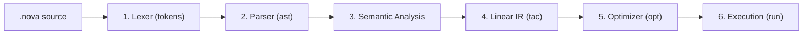

# NOVA Compiler — Live Demonstration Guide

This guide is designed for CSE students demonstrating the **NOVA Script Educational Compiler** to faculty examiners or project review panels. Follow these copy-pasteable steps while sharing your screen or terminal.

---

## 1. What is NOVA Compiler?

**NOVA Compiler** is an educational, end-to-end compiler built from scratch in C++17. It compiles a custom language called **NOVA Script**.

A compiler translates human-readable source code into simpler, machine-executable instructions through a sequence of structured stages: scanning characters, validating grammar, verifying semantics, generating intermediate code, and optimizing operations.

> [!IMPORTANT]
> **Key Distinction for Examiners:**
> **NOVA does NOT compile C++.** 
> - **Track 1 (This Demo):** The educational compiler processes **NOVA Script** (`.nova` files) — a clean, deterministic integer language with 64-bit two's complement wrapping semantics designed to teach compiler internals.
> - **Track 2 (SmartPass):** Uses external **GCC (`g++`)** to compile and autotune numerical C++ benchmarks.

---

## 2. What Do I Need?

To build and run the compiler, verify that your machine has the following tools installed:

1. **C++17 Compiler:** GCC / MinGW (`g++` 6.3.0 or higher), MSVC, or Clang.
2. **CMake:** Version 3.16 or higher (verified on CMake 4.4.4).
3. **Shell:** Windows PowerShell or Command Prompt.

### Check Your Environment

Open Windows PowerShell and check that CMake and your compiler are available:

```powershell
cmake --version
g++ --version
```

*(If `g++` is installed in `C:\MinGW\bin` and PowerShell cannot find it, run `$env:PATH = "C:\MinGW\bin;" + $env:PATH` in your current PowerShell session.)*

---

## 3. Build NOVA

All build artifacts are managed cleanly using CMake. From the repository root (`G:\Projects\NOVA`):

### Step 1: Configure the build directory
```powershell
cmake -B build -S .
```
*What this does:* Scans your system compiler, validates C++17 support, sets up include directories, and creates native Makefiles in the `build\` folder.

### Step 2: Compile the project
```powershell
cmake --build build
```
*What this does:* Compiles all library modules (`src/*.cpp`) and links the standalone command-line executable `build\nova.exe`.

### Step 3: Verify the executable
If the project is already built, check the binary directly:
```powershell
.\build\nova.exe --version
.\build\nova.exe --help
```
*Expected output:*
```text
nova 0.1.0
```

---

## 4. Run the First Example

The smallest valid example program in the repository is [`examples/basic.nova`](file:///G:/Projects/NOVA/examples/basic.nova).

### Source Code (`examples/basic.nova`)
```nova
let x = 10;
let y = 20;
let z = x * 2 + y;
print z;
```

### Command to Execute
```powershell
.\build\nova.exe run examples\basic.nova
```

### Expected Output
```text
40
```

*What happened:* The compiler lowered the source code into Three-Address Code and executed it using the built-in reference interpreter: $x = 10$, $y = 20$, $z = (10 \times 2) + 20 = 40$.

---

## 5. Show How the Compiler Works

NOVA exposes each internal compiler phase through dedicated command-line subcommands. Every stage can be inspected individually:



### Stage 1: Lexical Analysis (`tokens`)
Breaks raw source text into a stream of typed tokens with exact `line:column` source coordinates.

```powershell
.\build\nova.exe tokens examples\basic.nova
```

*Verified Output:*
```text
1:1 KW_LET 'let'
1:5 IDENTIFIER 'x'
1:7 ASSIGN '='
1:9 INTEGER '10'
1:11 SEMICOLON ';'
2:1 KW_LET 'let'
2:5 IDENTIFIER 'y'
...
4:1 KW_PRINT 'print'
4:7 IDENTIFIER 'z'
4:8 SEMICOLON ';'
5:1 EOF ''
```

### Stage 2: Recursive-Descent Parsing (`ast`)
Validates grammatical structure and builds a hierarchical Abstract Syntax Tree (AST), enforcing operator precedence (`*` binds tighter than `+`).

```powershell
.\build\nova.exe ast examples\basic.nova
```

*Verified Output:*
```text
Program
  Let x
    Integer 10
  Let y
    Integer 20
  Let z
    Binary +
      Binary *
        Variable x
        Integer 2
      Variable y
  Print
    Variable z
```

### Stage 3: Semantic Analysis & Symbol Checking
Checks scope, declare-before-use rules, and duplicate declarations. NOVA Script enforces a strict global scope where variables must be initialized upon declaration.

### Stage 4: Intermediate Code Generation (`tac`)
Lowers the hierarchical AST into linear **Three-Address Code (TAC)**. Complex expressions are flattened into simple instructions with at most one operator and two operands, introducing temporary variables (`$t1`, `$t2`, ...).

```powershell
.\build\nova.exe tac examples\basic.nova
```

*Verified Output:*
```text
x = 10
y = 20
$t1 = x * 2
z = $t1 + y
print z
```

### Stage 5: The 4-Pass Fixed-Point Optimizer (`opt`)
Simplifies TAC instructions using four cohesive passes repeated until reaching a fixed point:
1. **`fold` (Constant Folding):** Evaluates arithmetic on constants at compile time (e.g., `3 + 4 -> 7`).
2. **`propagate` (Constant Propagation):** Replaces variables assigned to constants with their literal values.
3. **`simplify` (Algebraic Simplification):** Applies identity laws (`x + 0 -> x`, `x * 1 -> x`, `x - x -> 0`).
4. **`dce` (Dead Code Elimination):** Removes variable assignments whose values are never used.

### Implementation Status Notice
- **Fully Implemented:** Lexer, Recursive-descent parser, AST dumper, Semantic symbol analysis, TAC generation, 4-pass TAC optimizer, and TAC/AST reference interpreters.
- **Explicitly Out of Scope:** NOVA Script does not generate raw x86 machine assembly or call external linkers; execution is performed by the verified reference interpreter.

---

## 6. A Short Faculty Demonstration (2–3 Minutes)

Follow this numbered script while presenting to examiners:

### Step 1: Open the Source File
Show the input file in your editor or terminal:
```powershell
Get-Content examples\basic.nova
```
*What to say:*
> *"Here is `basic.nova`. It is a simple NOVA Script program declaring variables `x` and `y`, computing an expression with mixed operator precedence, and printing the result."*

### Step 2: Show the Lexer
```powershell
.\build\nova.exe tokens examples\basic.nova
```
*What to say:*
> *"Our lexer converts characters into typed tokens. Notice how each token preserves exact line and column locations, which allows us to produce precise compiler diagnostics."*

### Step 3: Show the Syntax Tree (AST)
```powershell
.\build\nova.exe ast examples\basic.nova
```
*What to say:*
> *"The recursive-descent parser validates syntax and builds the Abstract Syntax Tree. In the node for variable `z`, notice that multiplication `x * 2` is nested deeper than addition `+ y`, demonstrating correct operator precedence."*

### Step 4: Show Intermediate Code (TAC)
```powershell
.\build\nova.exe tac examples\basic.nova
```
*What to say:*
> *"Next, semantic analysis verifies that variables are declared before use. It then lowers the nested tree into linearized Three-Address Code with explicit temporaries like `$t1`. Linear IR makes data-flow analysis and optimization straightforward."*

### Step 5: Execute the Program
```powershell
.\build\nova.exe run examples\basic.nova
```
*What to say:*
> *"The reference interpreter executes the Three-Address Code with 64-bit integer wrapping semantics, outputting `40`."*

### Step 6: The Showstopper — Optimization Passes
Run the optimizer on [`examples/optimize_demo.nova`](file:///G:/Projects/NOVA/examples/optimize_demo.nova) with `--show-all`:
```powershell
.\build\nova.exe opt examples\optimize_demo.nova --show-all
```
*What to say:*
> *"Here is our 4-pass optimizer in action with `--show-all`. Notice how it runs across iterations until reaching a fixed point:*
> - *In **Iteration 1**: Constant folding computes `3 + 4 -> 7` and `1 - 1 -> 0`. Constant propagation replaces variables with known constants. Algebraic simplification replaces `b + 0` with `b` and `b - b` with `0`. Dead code elimination removes unused values like variable `unused`.*
> - *In **Iteration 2**: The simplified operations cascade, folding `4 * 7 -> 28` and propagating `b = 8` directly into print statements.*
> - *By **Iteration 3**: The optimizer reaches a fixed point where no further rules apply, collapsing the entire program into just `print 8; print 28;`."*

### Step 7: Demonstrate Negative Error Handling
Demonstrate that the compiler catches mistakes before execution:
```powershell
.\build\nova.exe tokens examples\invalid_char.nova
.\build\nova.exe ast examples\invalid_syntax.nova
.\build\nova.exe tac examples\undeclared.nova
.\build\nova.exe run examples\divzero.nova
```
*What to say:*
> *"The compiler strictly rejects invalid programs at the earliest possible stage: unexpected characters at the lexer, syntax errors at the parser, and undeclared variables during semantic analysis. Division by zero is caught safely at runtime without crashing the host."*

---

## 7. Troubleshooting

| Issue | Likely Cause | Solution |
|---|---|---|
| `nova.exe: The term is not recognized...` | Executable has not been built yet or terminal is in the wrong directory. | Make sure you are in the repository root (`G:\Projects\NOVA`) and run `cmake --build build`. |
| `Illegal System DLL Relocation` | Windows sandbox or 32-bit MinGW runtime DLL path issue. | Run in native PowerShell and ensure MinGW's `bin` directory is in your path: `$env:PATH = "C:\MinGW\bin;" + $env:PATH`. |
| `g++: command not found` | MinGW / GCC is not added to the system `PATH`. | Add `C:\MinGW\bin` (or your compiler's installation path) to the Windows Environment Variables. |
| `cmake: command not found` | CMake is not installed or not in `PATH`. | Install CMake or add `C:\Program Files\CMake\bin` to `PATH`. |
| `runtime error: division by zero` | Input program divides by zero (e.g. `divzero.nova`). | This is expected behavior for `divzero.nova` (exits with code 1 by design). |
