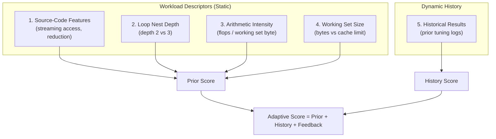

# NOVA SmartPass — Live Demonstration Guide

This guide is designed for CSE students demonstrating **NOVA SmartPass** to faculty examiners or review panels. Follow these copy-pasteable steps while sharing your screen or terminal.

---

## 1. What is SmartPass?

**NOVA SmartPass** is an autotuning and experiment controller framework for numerical C++ programs.

In SmartPass, **GCC (`g++`)** compiles the actual C++ program. SmartPass automates the search through compiler optimization flag combinations, validates output numerical correctness against an independent mathematical oracle, measures execution times with statistical noise controls, and selects a winning configuration under a strict evaluation budget.

> [!IMPORTANT]
> **Key Distinction for Examiners:**
> **SmartPass is NOT the NOVA Script educational compiler.**
> - **Track 1 (NOVA Script):** A custom educational compiler built from scratch for a small integer language.
> - **Track 2 (SmartPass):** An autotuning experiment controller that orchestrates **GCC (`g++`)** to optimize real numerical C++ kernels.

---

## 2. Prerequisites and Setup

Before starting the demonstration, verify that your machine has the required tools installed:

1. **GCC Compiler:** `g++` (MinGW GCC 6.3.0 or higher with C++17 support).
2. **CMake:** Version 3.16 or higher (verified on CMake 4.4.4).
3. **Shell:** Windows PowerShell or Command Prompt.

### Check Your Environment

Verify your compiler and CMake versions in Windows PowerShell:

```powershell
cmake --version
g++ --version
```

*(If `g++` is installed in `C:\MinGW\bin` and PowerShell cannot find it, run `$env:PATH = "C:\MinGW\bin;" + $env:PATH` in your current PowerShell session.)*

### Locate or Build SmartPass

SmartPass is integrated directly into the `nova.exe` command-line binary. If not already compiled, build it from the repository root (`G:\Projects\NOVA`):

```powershell
cmake -B build -S .
cmake --build build
```

Confirm that SmartPass subcommands are available:
```powershell
.\build\nova.exe bench list
```

---

## 3. Choose a Real C++ Example

NOVA includes three real, standard numerical C++ kernels in [`benchmarks/kernels/`](file:///G:/Projects/NOVA/benchmarks/kernels):
- [`stencil.cpp`](file:///G:/Projects/NOVA/benchmarks/kernels/stencil.cpp): 1-D Jacobi heat diffusion smoothing (spatial locality and cache reuse).
- [`matmul.cpp`](file:///G:/Projects/NOVA/benchmarks/kernels/matmul.cpp): Classic $O(n^3)$ double-precision matrix multiplication (compute and cache bound).
- [`vector_add.cpp`](file:///G:/Projects/NOVA/benchmarks/kernels/vector_add.cpp): Streaming vector addition $a_i \mathrel{+}= b_i$ over 16 passes (memory-bandwidth bound).

### For This Demo: `stencil.cpp`
We use [`benchmarks/kernels/stencil.cpp`](file:///G:/Projects/NOVA/benchmarks/kernels/stencil.cpp). It simulates iterative 1-D Jacobi heat smoothing across $n$ grid cells for 100 consecutive sweeps:
$$\text{next}[i] = 0.25 \cdot \text{cur}[i-1] + 0.5 \cdot \text{cur}[i] + 0.25 \cdot \text{cur}[i+1]$$

Each sweep depends on the values computed in the previous sweep, making it representative of scientific simulation codes.

*(Alternatively, [`examples/matmul.cpp`](file:///G:/Projects/NOVA/examples/matmul.cpp) is also provided in the repository as a standalone C++ example with no harness dependencies).*

---

## 4. Establish the GCC Baselines

First, demonstrate standard GCC compilation with default optimization levels `-O2` and `-O3`:

### Compile and Run GCC `-O2`
```powershell
g++ -O2 -I.\benchmarks\kernels .\benchmarks\kernels\stencil.cpp -o .\benchmarks\stencil_O2.exe
.\benchmarks\stencil_O2.exe 200000 1
```

### Compile and Run GCC `-O3`
```powershell
g++ -O3 -I.\benchmarks\kernels .\benchmarks\kernels\stencil.cpp -o .\benchmarks\stencil_O3.exe
.\benchmarks\stencil_O3.exe 200000 1
```

### Understanding `-O2` vs `-O3`
- **`-O2`** enables standard compiler optimizations without aggressive vectorization or loop unrolling. It is the default production optimization level for most software.
- **`-O3`** turns on aggressive loop vectorization, unrolling heuristics, and inline function cloning.
- **Why `-O3` is NOT guaranteed to be faster:** Generic compiler heuristics cannot predict hardware cache sizes or memory saturation for specific loops. Aggressive unrolling can cause instruction-cache bloat and register spilling, sometimes making `-O3` slower than `-O2`.

---

## 5. Run SmartPass

Now run SmartPass to autotune the `stencil` benchmark under a strict evaluation budget of **4 candidate configurations**:

```powershell
.\build\nova.exe tune stencil --budget=4 --strategy=adaptive --seed=1 --reps=5 --warmup=1 --pilot-reps=3 --affinity=10 --high-priority --id=demo-tune --out=build\demo-run
```

### Explanation of Command-Line Arguments:
- `stencil`: Name of the registered numerical workload.
- `--budget=4`: Maximum number of searched candidate configurations to evaluate.
- `--strategy=adaptive`: Uses workload descriptors and historical evidence to pick candidates.
- `--seed=1`: Controls search randomization for deterministic reproducibility.
- `--reps=5`: Collects 5 timed measurement repetitions per candidate.
- `--warmup=1`: Discards 1 initial warm-up run to ensure CPU cache lines are primed.
- `--pilot-reps=3`: Performs 3 quick pilot comparisons against the baseline anchor.
- `--affinity=10`: Pins the process to CPU core mask `0x10` (core 4) to eliminate OS thread-migration noise.
- `--high-priority`: Sets process priority to high to prevent background scheduling interruptions.
- `--id=demo-tune`: Human-readable identifier for this experiment run.
- `--out=build\demo-run`: Directory where binaries, raw measurements, and JSON manifests are saved.

### View the Results and Explanation
To inspect the candidate rankings and selection breakdown:
```powershell
.\build\nova.exe explain build\demo-run
```

---

## 6. Explain the Four-Candidate Budget

### Key Terminology
- **Candidate:** One specific compiler configuration / flag combination (e.g., `-O3 -funroll-loops -march=native`).
- **Budget:** The maximum permitted number of search candidate evaluations (`--budget=B`, here $B=4$).
- **Binary:** The compiled executable generated by GCC using a candidate's flags.
- **Baseline / Anchor:** The reference configurations (`-O2` and `-O3`). `-O2` serves as the primary anchor for binary growth policy and log-gain speedup calculations.

### Budget Accounting Rules
SmartPass enforces strict, verifiable accounting rules during execution:
1. **Baselines are free:** The two baselines (`-O2` and `-O3`) are always built and evaluated first; they do **not** consume any of the 4 search candidate budget.
2. **Build failures count:** If a candidate flag combination causes GCC compilation to fail, it counts as 1 candidate evaluation against the budget, is marked `BUILD_FAILED`, and is immediately disqualified.
3. **Correctness failures count:** If a compiled candidate produces incorrect numerical results during oracle validation, it counts against the budget, is marked `CORRECTNESS_FAILED`, and is immediately disqualified from timing.
4. **Policy rejections:** Any candidate that exceeds the maximum binary growth limit (`--max-binary-growth=2.0`, or twice the `-O2` binary size) or fails to complete all repetitions is marked `REJECTED_BY_POLICY`.
5. **Eligibility:** Only candidates that successfully compile, pass the numerical correctness gate, complete all timing repetitions, and satisfy binary size policies receive `ELIGIBLE` status and compete for the `WINNER` title.

---

## 7. Explain Adaptive Search

SmartPass navigates the 22 candidate configurations in the search space using **five intended signals**:



### The 5 Signals in Detail
1. **Source-Code Features:** Inspects memory access and reduction patterns (`unit_stride_streaming`, `innermost_reduction`). Streaming loops with no scalar reduction receive higher prior scores for vectorization (`-ftree-vectorize`) and loop unrolling (`-funroll-loops`).
2. **Loop Depth:** `loop_nest_depth` (e.g. depth 2 for `stencil`, depth 3 for `matmul`).
3. **Arithmetic Intensity:** `flops_per_byte` calculates nominal floating-point operations divided by working set bytes.
4. **Memory-Bandwidth Requirements:** `working_set_bytes` models memory pressure. When working set size exceeds 4 MB (exceeding typical L2/L3 cache slices), the prefetching flag (`-fprefetch-loop-arrays`) receives an increased prior score (weight 1.0 vs 0.3).
5. **Historical Candidate Results:** `history(index)` loads prior tuning records from `--history=FILE` on tuning sizes, weighting past speedups by workload family similarity and log-size distance ($\exp(-\Delta \text{size}_{\log_2} / 4)$) with shrinkage.

### Implemented vs Experimental Status
- **Implemented:** The scoring formula `score = prior + history + feedback` is fully implemented in `src/tune/adaptive.cpp`. Ablation flags (`--ablation=no-features`, `--ablation=no-history`, `--ablation=no-feedback`) allow testing each signal in isolation.
- **Empirical Research Finding:** Evaluated across thousands of replays, adaptive search consistently beats random search under tight budgets ($B \le 4$). However, isolating feature priors versus history priors individually produced differences smaller than benchmark noise (disclosed in project report).

---

## 8. Explain Correctness Checking

Every compiled candidate must pass through the **Correctness Oracle Gate** before it is timed.

### Independent Oracle
The harness contains an independent reference implementation (`src/bench/registry.cpp`) that calculates reference results using `long double` precision, completely independent of the kernel source code.

### The 5 Numerical Invariants
Instead of allocating millions of elements in memory for full-array comparison, the oracle verifies 5 statistical invariants:
1. **Total scalar sum (`out.sum`):** Sum of all output array elements.
2. **First output element (`out.s0`):** `v[0]`.
3. **Middle output element (`out.s1`):** `v[v.size() / 2]`.
4. **Final output element (`out.s2`):** `v[v.size() - 1]`.
5. **Weighted-index checksum (`out.wsum`):** $\sum ((i \pmod 7) + 1) \cdot v[i]$.

### Tolerance Formula
A candidate passes if and only if every statistic satisfies:
$$| \text{actual} - \text{expected} | \le \text{tolerance} \times \max(1.0, | \text{expected} |)$$
where $\text{tolerance} = 10^{-9}$ (`kRelativeTolerance = 1e-9`).

> [!NOTE]
> These statistical checks catch floating-point precision loss, instruction reordering errors, and memory corruption without imposing heavy memory overhead. They are rigorous validation signals, though not formal mathematical proofs for all possible inputs.

---

## 9. Demonstration (Step-by-Step)

Follow this live walkthrough during your presentation:

### Step 1: Open the C++ Kernel Source
```powershell
Get-Content benchmarks\kernels\stencil.cpp -TotalCount 25
```

### Step 2: List Registered Workloads
```powershell
.\build\nova.exe bench list
```

### Step 3: Run SmartPass Tuning
```powershell
.\build\nova.exe tune stencil --budget=4 --strategy=adaptive --seed=1 --reps=5 --warmup=1 --pilot-reps=3 --affinity=10 --high-priority --id=demo-tune --out=build\demo-run
```

*Expected Terminal Progression:*
```text
tuning stencil -> build\demo-run
build O2 ... ok
build O3 ... ok
build O3+prefetch+unroll+native ... ok
build O3+unroll+native ... ok
build O2+prefetch+vec+unroll+native ... ok
build O3+vec+unroll+native ... ok
  validate O2 n=200000: PASS
  validate O3 n=200000: PASS
  validate O3+prefetch+unroll+native n=200000: PASS
  validate O3+unroll+native n=200000: PASS
  validate O2+prefetch+vec+unroll+native n=200000: PASS
  validate O3+vec+unroll+native n=200000: PASS
  ...
```

### Step 4: Inspect the Explanation Table
```powershell
.\build\nova.exe explain build\demo-run
```

*Expected Output (from real runs in `docs/DEMO.md`):*
```text
SmartPass tuning result: stencil, input size 200000, experiment demo-tune
strategy adaptive (search seed 1), budget 4 search candidates; evaluated 4 + baselines (6 builds total)

  rank  candidate                       state                 median_ms   IQR_ms  size_bytes  note
     6  O2                              ELIGIBLE                16.1736   0.0790       81660  
     5  O3                              ELIGIBLE                11.9338   0.2725       81746  
     2  O3+prefetch+unroll+native       ELIGIBLE                 8.9703   0.2548       86866  
     1  O3+unroll+native                ELIGIBLE                 8.8802   0.1064       84306  WINNER
     3  O2+prefetch+vec+unroll+native   ELIGIBLE                 8.9868   0.1239       87292  
     4  O3+vec+unroll+native            ELIGIBLE                 9.0210   0.1412       87450  

winner: O3+unroll+native [-std=c++17 -msse2 -mfpmath=sse -O3 -funroll-loops -march=native], median 8.8802 ms over 5 samples
best baseline: O3, median 11.9338 ms; ratio of medians 1.344; interquartile ranges are disjoint
```

### Step 5: Show Holdout Size Protection (Preventing Data Leakage)
Show that SmartPass strictly forbids tuning directly on holdout evaluation sizes:
```powershell
.\build\nova.exe tune matmul --budget=2 --size=320
```
*Expected Output:*
```text
nova tune: size 320 is a reserved holdout size of 'matmul'; tuning may not use holdout sizes
```

---

## 10. How to Explain the Result to Faculty

Use this spoken script when explaining SmartPass to your review panel:

> *"In numerical computing, developers commonly default to `-O2` or `-O3`. However, generic compiler heuristics cannot optimize for specific cache hierarchies or memory access patterns. For example, standard `-O3` takes ~11.9 ms on this stencil workload.*
> 
> *Evaluating dozens of compiler configurations in production or CI/CD pipelines is too slow and expensive. SmartPass solves this by using **adaptive search under a tight budget of just 4 candidate evaluations**.*
> 
> *Before any candidate is timed, it must pass our **Correctness Oracle Gate**, verifying 5 numerical statistics against an independent `long double` reference within a relative tolerance of $10^{-9}$. Any candidate causing precision drift is disqualified.*
> 
> *Here, SmartPass discovered that combining `-O3` with loop unrolling and native architecture instructions (`-O3 -funroll-loops -march=native`) achieved a **1.34x speedup** over default `-O3` with completely disjoint interquartile ranges.*
> 
> *Finally, to maintain scientific rigor, these gains are validated on held-out problem sizes to confirm they generalize and do not overfit to a single input dimension."*

---

## 11. Troubleshooting

| Issue | Likely Cause | Solution |
|---|---|---|
| `g++: command not found` | MinGW GCC is not installed or not in Windows `PATH`. | Ensure MinGW `bin` directory is in PATH: `$env:PATH = "C:\MinGW\bin;" + $env:PATH`. |
| `size ... is a reserved holdout size` | Attempting to tune on a reserved holdout size (e.g. 320 for `matmul`). | Use a designated tuning size (e.g., 256 for `matmul`, 200000 for `stencil`). |
| `Illegal System DLL Relocation` | Windows sandbox DLL address conflict with 32-bit MinGW binaries. | Run the command directly in a native PowerShell terminal. |
| `affinity mask error` | CPU core mask `0x10` does not exist on machines with fewer than 5 cores. | Use `--affinity=1` (core 0) or omit `--affinity` to use the system default. |
| `results directory does not exist` | Trying to run `explain` on a non-existent directory. | Run the `tune` command first with `--out=build\demo-run`. |
