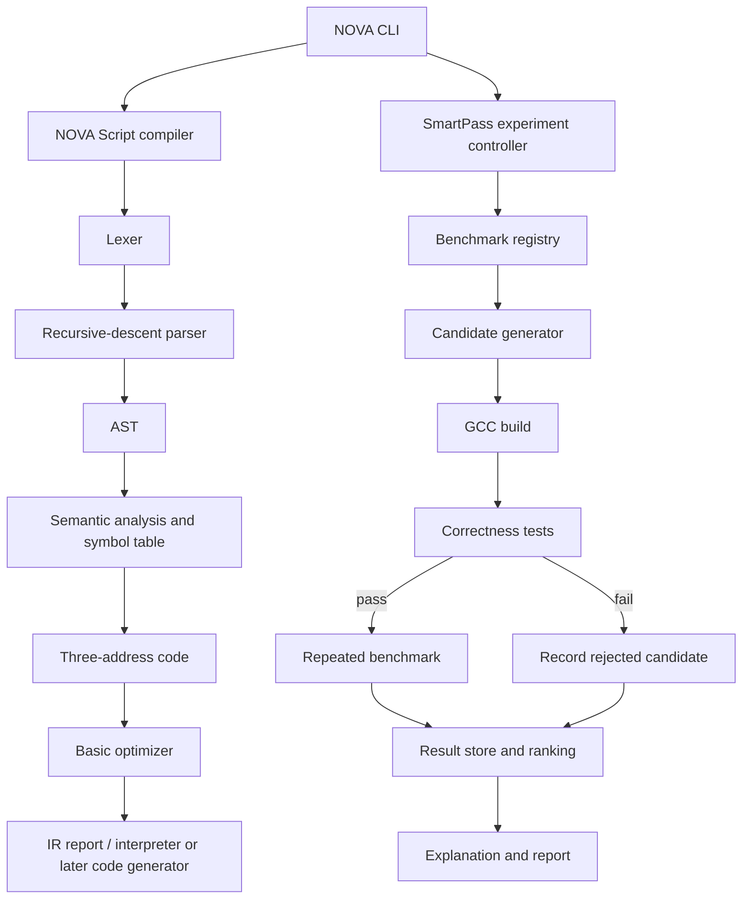

# 02 — Architecture and Workings

## 1. Two-track architecture



The Mermaid diagram is a proposed design, not a screenshot of implemented software.

## 2. NOVA Script language — initial grammar

Start small. Version 0.1 supports integer variables, arithmetic, assignment and `print`. Add `if` and `while` only after the initial frontend is stable.

Example:

```text
let x = 10;
let y = 20;
let z = x * 2 + y;
print z;
```

A minimal grammar:

```ebnf
program     = { statement } ;
statement   = "let" identifier "=" expression ";"
            | identifier "=" expression ";"
            | "print" expression ";" ;
expression  = term { ("+" | "-") term } ;
term        = unary { ("*" | "/") unary } ;
unary       = [ "-" ] primary ;
primary     = integer | identifier | "(" expression ")" ;
```

Implementation note: if unary operators or declarations are not implemented in the current phase, remove them from the accepted grammar rather than accepting syntax the parser cannot correctly handle.

## 3. Frontend components

### Lexer
Input: source text. Output: token sequence with kind, lexeme and source location.
- Must distinguish `=` assignment from `==` comparison once comparisons are introduced.
- Must report unknown characters with location.
- Must have tests for empty input, whitespace, comments, integers, identifiers and invalid symbols.

### Parser
Use recursive descent for statements and precedence-layered expression parsing.
- A parser error should include the unexpected token and source location.
- Do not use string matching as a substitute for parsing.
- AST nodes should represent meaning, not just retain source strings.

### AST
Recommended node families:
- `Program`
- `LetStmt`, `AssignStmt`, `PrintStmt`
- `IntegerExpr`, `VariableExpr`, `UnaryExpr`, `BinaryExpr`

Use `std::unique_ptr` for AST ownership or another consistent ownership strategy. Avoid raw owning pointers.

### Semantic analysis and symbol table
Initial type system: integers only.
- Reject use-before-declaration.
- Reject duplicate declarations in the same scope.
- Reject invalid assignment targets.
- Define division behavior explicitly; do not leave divide-by-zero behavior ambiguous.
- If lexical scopes are added later, represent them explicitly.

### Three-address code (TAC)
Example expression:

```text
let z = x * 2 + y;
```

Possible TAC:

```text
t1 = x * 2
t2 = t1 + y
z = t2
```

The exact temporary naming policy should be deterministic to make golden tests reliable.

## 4. Basic optimizer

Passes are educational and should be independently testable:
1. Constant folding: `t1 = 2 + 3` → `t1 = 5`
2. Constant propagation: `x = 4; y = x + 1` → `x = 4; y = 5` where semantics permit.
3. Algebraic simplification: `x + 0` → `x`, only when valid under language semantics.
4. Dead-code elimination: remove assignments whose values are never used, provided removal cannot remove observable effects or exceptions.

Rules:
- Preserve semantics.
- Avoid unsafe floating-point identities if floating point is later added.
- Run differential tests against a reference interpreter for randomly generated small programs where feasible.
- Document which optimizations are implemented; do not advertise future passes as completed.

## 5. SmartPass data model

Each experiment should capture:
- experiment ID and timestamp;
- benchmark ID and source hash;
- input parameters and correctness test set;
- host compiler name/version;
- exact argument vector for each candidate;
- NOVA version / Git commit;
- OS, CPU model, logical core count, RAM and relevant environment;
- build status, correctness status and failure reason;
- raw timing samples, median, minimum and spread statistic;
- binary size;
- tuning budget, number of candidates attempted and total tuning wall time;
- selection rule and selected candidate ID.

Use JSON for full metadata and CSV for a flat candidate table. Do not store only the best candidate.

## 6. Candidate lifecycle

```text
GENERATED
  -> BUILD_FAILED                 (record; never benchmark)
  -> BUILT
       -> CORRECTNESS_FAILED      (record; never rank as valid)
       -> CORRECT
            -> BENCHMARKED
                 -> ELIGIBLE
                 -> REJECTED_BY_POLICY
```

A candidate with missing correctness results is not eligible. A candidate with fewer timing samples than the configured protocol should be marked incomplete.

## 7. Search strategy, staged

### First working version
Use a deterministic candidate list and a fixed budget. Include `-O2` and `-O3` as baselines. This is not yet adaptive research.

### Adaptive version
Use a small, inspectable heuristic:
- collect workload descriptors (e.g., matrix dimension, element type, operation family, whether loop tiling is a legal kernel parameter);
- collect previous outcomes for each candidate/configuration family;
- prioritize untested candidates expected to improve the objective;
- preserve exploration so the algorithm does not only repeat one family;
- compare against random search with the same candidate budget.

Do not claim this is machine learning unless a real learned model is implemented and evaluated. A transparent heuristic is easier to explain and can still be evaluated.

## 8. Security and process safety
- Invoke the compiler using a process API with separate arguments.
- Do not concatenate user-provided source paths or flags into shell commands.
- Restrict generated candidate flags to a whitelist.
- Use per-candidate output directories.
- Apply timeouts to build and benchmark processes.
- Capture stdout/stderr and exit codes.
- Avoid running arbitrary downloaded binaries; the initial tool should operate only on local project-controlled benchmark sources.
